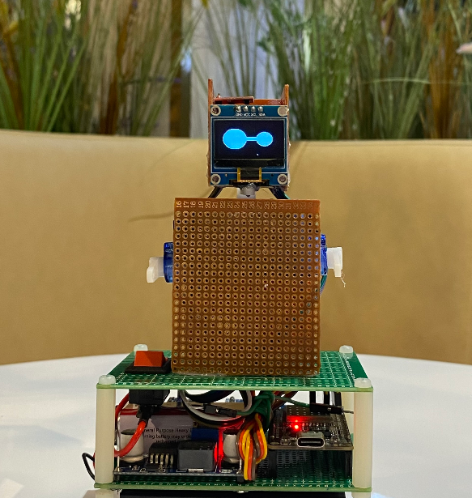
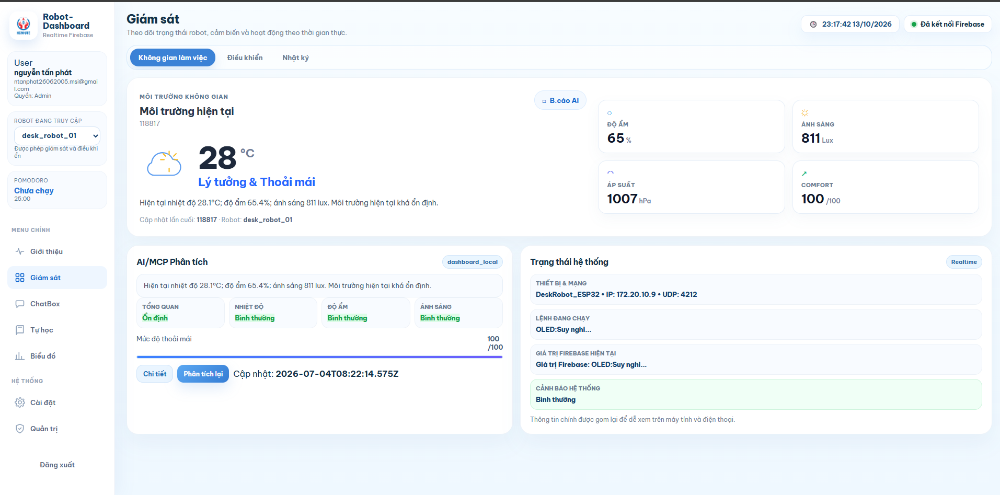
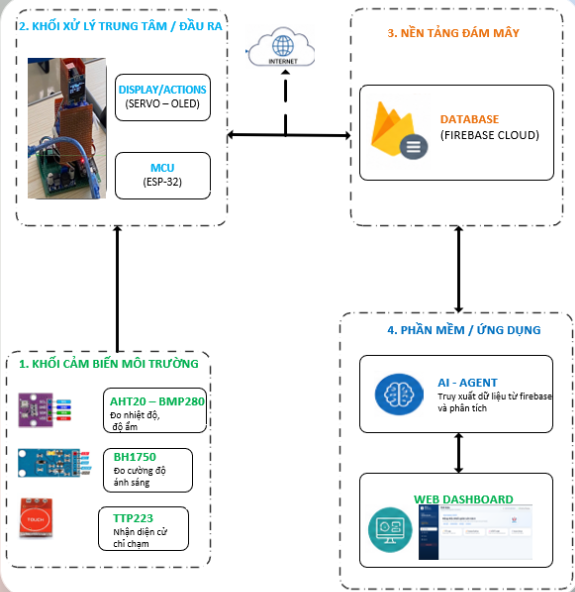
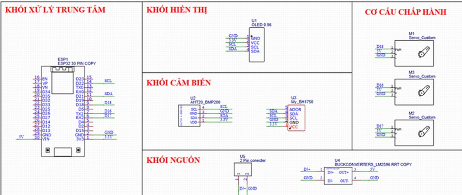
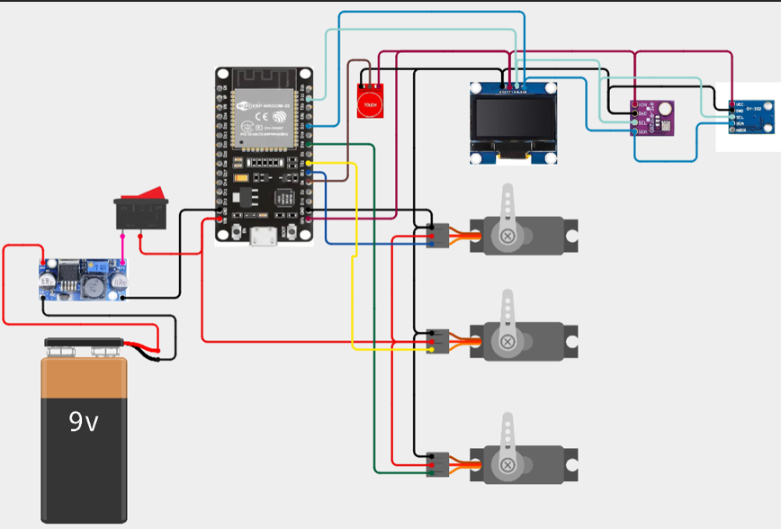

# Desk Robot

**Robot để bàn hỗ trợ học tập, giám sát môi trường và tương tác với AI.**

Desk Robot kết hợp phần cứng ESP32, dashboard web và ứng dụng Python để tạo một trợ lý đặt tại góc học tập. Robot đo điều kiện môi trường, hiển thị thông tin và biểu cảm trên OLED, chuyển động bằng servo và hỗ trợ phiên học Pomodoro. Dashboard giúp người dùng theo dõi dữ liệu, điều khiển robot và quản lý hoạt động học tập; ứng dụng Python bổ sung khả năng hỏi đáp bằng model chạy cục bộ qua Ollama.

Đây là dự án nguyên mẫu phục vụ học tập và thử nghiệm tích hợp IoT với AI. Repository bao gồm firmware, giao diện web, ứng dụng desktop và tài liệu phần cứng.

<p align="center">
  
</p>

<p align="center"><em>Nguyên mẫu robot: OLED phía trên hiển thị biểu cảm, khung nhiều tầng bố trí mạch điều khiển, dây kết nối và nguồn.</em></p>

## Chức năng chính

| Nhóm chức năng      | Mô tả                                                                             |
| ------------------- | --------------------------------------------------------------------------------- |
| Giám sát môi trường | Theo dõi nhiệt độ, độ ẩm, ánh sáng, áp suất và độ cao ước tính từ cảm biến        |
| Tương tác với robot | Hiển thị biểu cảm OLED, điều khiển đầu và hai tay bằng servo, nhận thao tác chạm  |
| Hỗ trợ tập trung    | Pomodoro với phiên học 25 phút và nghỉ 5 phút trong firmware                      |
| Dashboard web       | Hiển thị trạng thái thiết bị, biểu đồ, nhật ký và điều khiển qua Firebase         |
| Quản lý học tập     | Giao diện lịch học, ghi chú và tác vụ học tập                                     |
| Trợ lý AI cục bộ    | Hỏi đáp và phân tích ngữ cảnh môi trường, tác vụ trong ứng dụng Python qua Ollama |
| Quản trị demo       | Quản lý tài khoản, vai trò và robot được truy cập trên giao diện web              |

## Giao diện dashboard



Dashboard tập hợp dữ liệu cảm biến, trạng thái kết nối và thông tin robot trong một màn hình. Người dùng có thể chuyển giữa không gian làm việc, điều khiển và nhật ký; các trang riêng hỗ trợ ChatBox, tự học, biểu đồ và quản trị.

Khu vực **AI/MCP Phân tích** hiển thị nhận xét môi trường và chỉ số thoải mái tham khảo. Dashboard có thể tính nhận xét bằng các quy tắc cục bộ khi chưa có kết quả từ agent bên ngoài. Nhãn `dashboard_local` trong ảnh thể hiện nguồn phân tích này; chỉ số thoải mái là giá trị do phần mềm tính, không phải đại lượng đo trực tiếp từ cảm biến.

_Ảnh ghi lại trạng thái tại thời điểm chụp; số liệu và trạng thái thay đổi theo dữ liệu Firebase._

## Kiến trúc hệ thống

<p align="center">
  
</p>

Hệ thống được tổ chức thành bốn khối:

1. **Cảm biến:** AHT20 đo nhiệt độ và độ ẩm, BMP280 cung cấp áp suất để ước tính độ cao, BH1750 đo ánh sáng và TTP223 nhận thao tác chạm.
2. **Xử lý và tương tác:** ESP32 đọc cảm biến, quản lý OLED, servo và trạng thái Pomodoro; firmware đẩy dữ liệu môi trường lên Firebase theo chu kỳ khoảng 10 giây.
3. **Đồng bộ dữ liệu:** Firebase Realtime Database lưu thông số, trạng thái robot và yêu cầu điều khiển. Dashboard theo dõi thay đổi tại các node này để cập nhật giao diện.
4. **Phần mềm:** dashboard web phục vụ giám sát và điều khiển; ứng dụng Python cung cấp giao diện trò chuyện, đọc ngữ cảnh từ Firebase và gọi Ollama trên máy tính.

Luồng giám sát và điều khiển trong firmware/dashboard:

```text
Cảm biến → ESP32 → Firebase → Dashboard
Dashboard → Firebase/CommandRequest → ESP32 → OLED và servo
ESP32 → Firebase/CommandAck → Dashboard
```

Sơ đồ kiến trúc thể hiện hướng tích hợp tổng thể. Ứng dụng Python hiện hoạt động qua giao diện desktop; việc nối luồng ChatBox từ web đến Python cần bổ sung agent xử lý yêu cầu. Chi tiết nằm ở phần [Trạng thái tích hợp](#trạng-thái-tích-hợp).

### Tổ chức dữ liệu

Firmware và dashboard sử dụng cấu trúc theo từng robot:

```text
RobotDashboard/
└── Robots/
    └── <robotId>/
        ├── RobotInfo/
        ├── ThongSo/
        ├── ThietBi/
        │   ├── CommandRequest/
        │   └── CommandAck/
        ├── Dashboard/
        ├── Pomodoro/
        ├── ChatBox/
        └── MCP/
            └── EnvironmentAnalysis/
```

`CommandRequest` và `CommandAck` mang mã yêu cầu cùng các mốc thời gian để theo dõi việc nhận, thực thi lệnh và đo độ trễ. `ROBOT_ID` trong firmware phải trùng với robot được chọn và cấp quyền trên dashboard.

## Thiết kế phần cứng

### Linh kiện chính

| Linh kiện                          | Vai trò                                                     |
| ---------------------------------- | ----------------------------------------------------------- |
| ESP32                              | Bộ điều khiển trung tâm và kết nối Wi-Fi                    |
| OLED SSD1306, 128 × 64             | Hiển thị biểu cảm, thông số môi trường, đồng hồ và Pomodoro |
| AHT20 và BMP280                    | Đo nhiệt độ, độ ẩm và áp suất                               |
| BH1750                             | Đo độ rọi của môi trường                                    |
| TTP223                             | Nhận thao tác chạm và giữ                                   |
| 3 servo                            | Điều khiển đầu, tay trái và tay phải                        |
| Nguồn, công tắc và bộ hạ áp LM2596 | Khối cấp nguồn theo sơ đồ đấu nối                           |

### Sơ đồ nguyên lý



Sơ đồ phân tách các khối xử lý, hiển thị, cảm biến, cơ cấu chấp hành và nguồn. OLED cùng các cảm biến môi trường dùng bus I2C; servo và cảm biến chạm có chân tín hiệu riêng.

### Sơ đồ đấu nối



Sơ đồ đấu nối minh họa vị trí các module và đường kết nối giữa chúng. Bảng dưới ghi các chân đang được khai báo trong firmware để đối chiếu khi lắp ráp hoặc thay đổi phần cứng.

| Tín hiệu             | GPIO trong firmware |
| -------------------- | ------------------- |
| I2C SDA              | 21                  |
| I2C SCL              | 22                  |
| Cảm biến chạm TTP223 | 4                   |
| Servo đầu            | 18                  |
| Servo tay trái       | 16                  |
| Servo tay phải       | 17                  |
| Buzzer               | 27                  |
| LED trạng thái       | 2                   |

Buzzer và LED là các đầu ra bổ sung được firmware sử dụng. Các hình phần cứng là tài liệu minh họa; khi thay đổi cách đấu nối, cập nhật các hằng số GPIO tương ứng trong sketch.

## Thành phần trong repository

| File hoặc thư mục        | Chức năng                                                                  |
| ------------------------ | -------------------------------------------------------------------------- |
| `robot_cua_tan_phat.ino` | Firmware ESP32: cảm biến, OLED, servo, Pomodoro và Firebase                |
| `AI_local.PY`            | Ứng dụng Tkinter: trò chuyện, đọc ngữ cảnh, quản lý tác vụ và gửi lệnh UDP |
| `settings.py`            | Đọc cấu hình Python từ biến môi trường hoặc `.env`                         |
| `index.html`             | Dashboard giám sát, điều khiển và quản lý học tập                          |
| `login.html`             | Giao diện đăng ký, đăng nhập và OTP EmailJS cho bản demo                   |
| `emailjs-test.html`      | Kiểm tra cấu hình gửi email                                                |
| `assets/` và `images/`   | Tài nguyên giao diện web                                                   |
| `docs/images/`           | Ảnh sản phẩm, dashboard, kiến trúc và sơ đồ phần cứng trong README         |
| `database.rules.json`    | Firebase Rules của bản demo                                                |

## Cấu hình

| File riêng trên máy | File mẫu được commit | Nội dung                          |
| ------------------- | -------------------- | --------------------------------- |
| `.env`              | `.env.example`       | Địa chỉ ESP32, Firebase và Ollama |
| `config.local.js`   | `config.example.js`  | Firebase Web và EmailJS           |
| `secrets.h`         | `secrets.example.h`  | Wi-Fi và Firebase cho ESP32       |

Khi clone trên máy mới, tạo cấu hình bằng PowerShell:

```powershell
Copy-Item .env.example .env
Copy-Item config.example.js config.local.js
Copy-Item secrets.example.h secrets.h
```

Điền thông tin của bạn vào ba file vừa tạo. Nếu chúng đã tồn tại, hãy sửa trực tiếp để giữ cấu hình hiện tại. Biến môi trường của hệ điều hành được ưu tiên hơn `.env`.

`ROBOT_ID` trong firmware phải trùng với robot được cấp quyền trên dashboard. `DATABASE_URL` trong `secrets.h` cần có dấu `/` ở cuối.

## Chạy Python

Yêu cầu Python 3.10 trở lên có Tkinter và Ollama đang hoạt động.

Model mặc định trong file mẫu là `qwen2.5:3b`. Suy luận AI chạy trên máy tính; Firebase và EmailJS vẫn sử dụng kết nối mạng.

```powershell
python -m venv .venv
.\.venv\Scripts\Activate.ps1
python -m pip install -r requirements.txt
ollama pull qwen2.5:3b
ollama serve
```

Mở terminal khác, kích hoạt môi trường ảo và chạy:

```powershell
python AI_local.PY
```

Đổi `OLLAMA_MODEL` trong `.env` nếu dùng model khác. Kiểm tra kết nối mạng, `ESP32_IP` và `ESP32_PORT` trước khi điều khiển robot.

## Chạy dashboard

Sau khi điền `config.local.js`, chạy máy chủ web cục bộ:

```powershell
python -m http.server 8000 --bind 127.0.0.1
```

Mở `http://127.0.0.1:8000/login.html`. Dùng `emailjs-test.html` để kiểm tra cấu hình EmailJS. Tên tham số OTP phải khớp với template của bạn.

Khi triển khai website, cung cấp cấu hình web qua bước triển khai riêng. Không đưa `.env` hoặc `secrets.h` vào thư mục web công khai.

## Nạp firmware

Mở sketch bằng Arduino IDE với board ESP32, đặt `secrets.h` cạnh file `.ino` và cài các thư viện:

- Adafruit GFX, Adafruit SSD1306, Adafruit AHTX0 và Adafruit BMP280
- BH1750
- ESP32Servo
- Firebase ESP Client

Kiểm tra các chân GPIO trước khi nạp; lấy IP của ESP32 từ Serial Monitor.

## Trạng thái tích hợp

Các thành phần hiện chưa dùng cùng một hợp đồng dữ liệu và kênh điều khiển:

- **Firmware và dashboard:** dùng các node tại `RobotDashboard/Robots/<robotId>`; firmware nhận yêu cầu điều khiển qua Firebase.
- **Python desktop:** mặc định đọc các node cũ như `ThongSo`, `Task` và `ChatBox` tại gốc database. Cần thống nhất đường dẫn khi dùng chung dữ liệu với dashboard.
- **ChatBox trên web:** ghi câu hỏi lên Firebase; `AI_local.PY` chưa có vòng lặp nhận và xử lý các yêu cầu này tự động.
- **Kênh UDP:** Python có chức năng gửi lệnh UDP, nhưng sketch đi kèm chưa có bộ nhận UDP tương ứng.
- **AI/MCP:** dashboard đọc kết quả phân tích nếu có và hỗ trợ tính nhận xét cục bộ; repository chưa kèm một MCP server hoặc agent xử lý nền cho luồng này.

Các điểm trên là phạm vi tích hợp còn cần hoàn thiện khi triển khai toàn bộ hệ thống.

## Định dạng code

Cài công cụ Python và Prettier; Prettier cần Node.js 18 trở lên:

```powershell
python -m pip install -r requirements-dev.txt
npm ci
```

Định dạng và kiểm tra:

```powershell
python -m black AI_local.PY settings.py
clang-format -i robot_cua_tan_phat.ino secrets.example.h
npm run format
python -m black --check AI_local.PY settings.py
npm run format:check
```

Quy tắc nằm trong `pyproject.toml`, `.prettierrc.json`, `.clang-format` và `.editorconfig`.

